# Product Search System

A small e-commerce store built on the MEAN stack, with Elasticsearch handling product search. The storefront is called **Common Goods**: browse a catalogue, search with typo tolerance and autocomplete, filter by category, brand, price and stock, add things to a bag and check out. There's also an inventory screen for adding, editing and removing products.

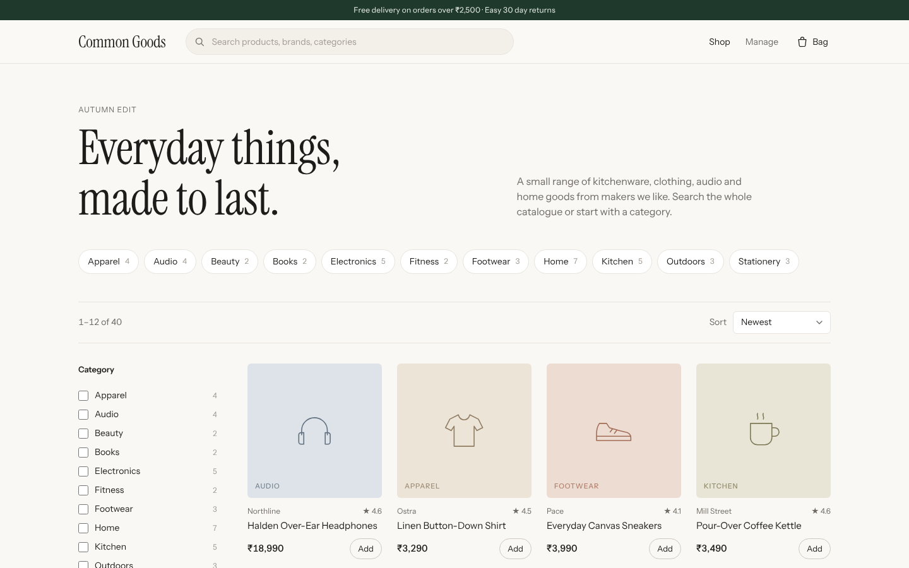

## What's in it

**Storefront**
- Search box with live suggestions for products and categories (keyboard friendly)
- Typo tolerant search. "hedphones" finds headphones, "cofee grindr" finds the grinder
- "Did you mean" when nothing matches
- Filters for category, brand, price range and stock, with counts next to each option
- Sort by relevance, newest, price, rating or name
- Every filter, sort and page lives in the URL, so results can be bookmarked or shared and the back button works
- Product pages with related items
- Bag drawer (kept in local storage), free delivery threshold and a cash on delivery checkout
- Works on phones; filters slide in from the side

**Inventory** (admin only)
- Staff sign-in with a hashed password and a secure session cookie
- Table of products with quick filtering and stock status
- Create and edit form with validation, plus a live preview of the product card
- Delete with a confirm step
- Button to rebuild the search index, and a status light showing whether Elasticsearch is reachable

**Backend**
- REST API in Express with full CRUD
- MongoDB is the source of truth; every write is pushed to Elasticsearch straight away
- If Elasticsearch goes down, search falls back to MongoDB and the shop keeps working. Writes made in the meantime are synced once it's back
- Reindexing builds a fresh index and swaps an alias over, so search never sees a half-built index
- Every change to products needs an admin session; reading and searching are public
- Security headers, rate limits, and a lockout after 5 wrong passwords

## Screenshots

| | |
|---|---|
| 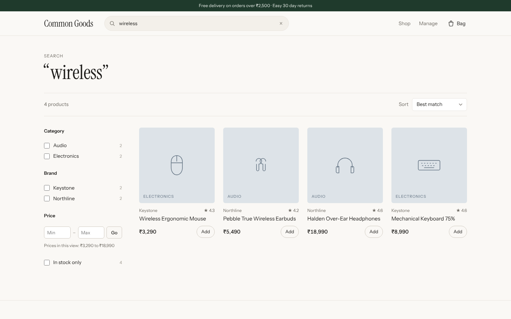 | 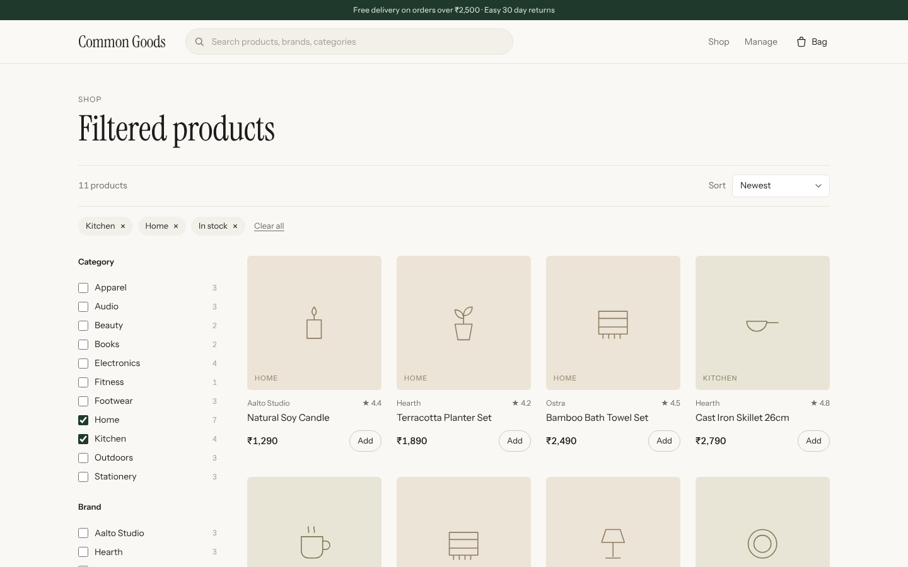 |
| Search results for "wireless" | Several filters at once, cheapest first |
| 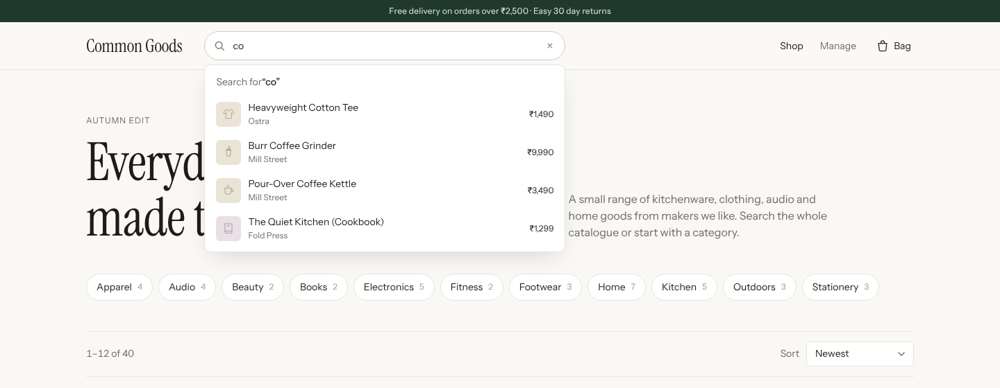 | 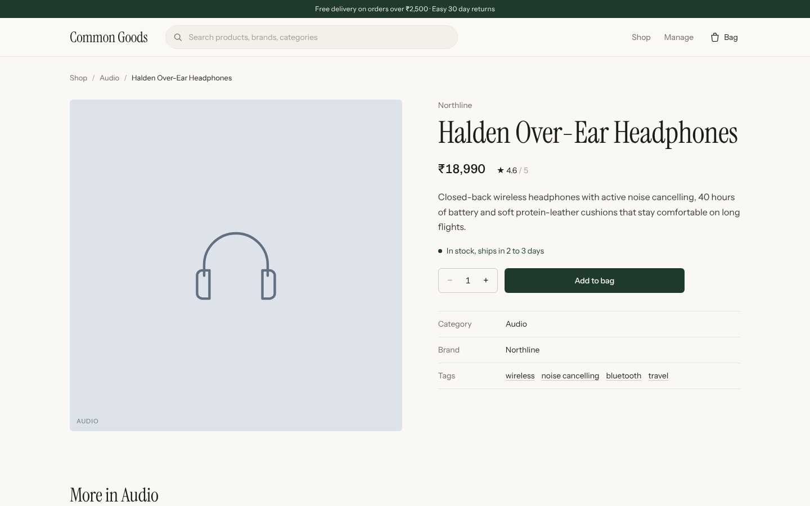 |
| Suggestions while typing | Product page |
| 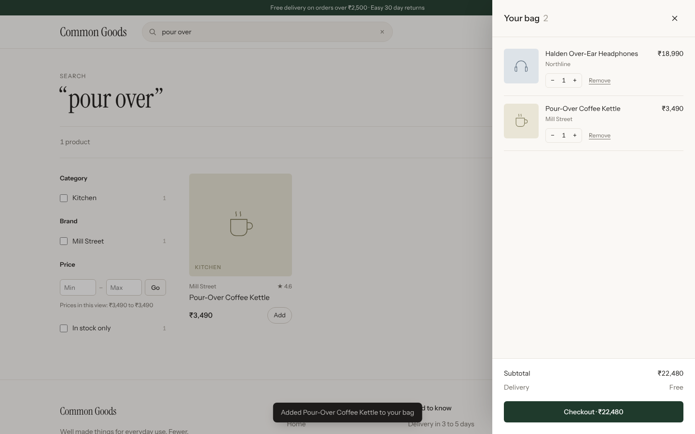 | 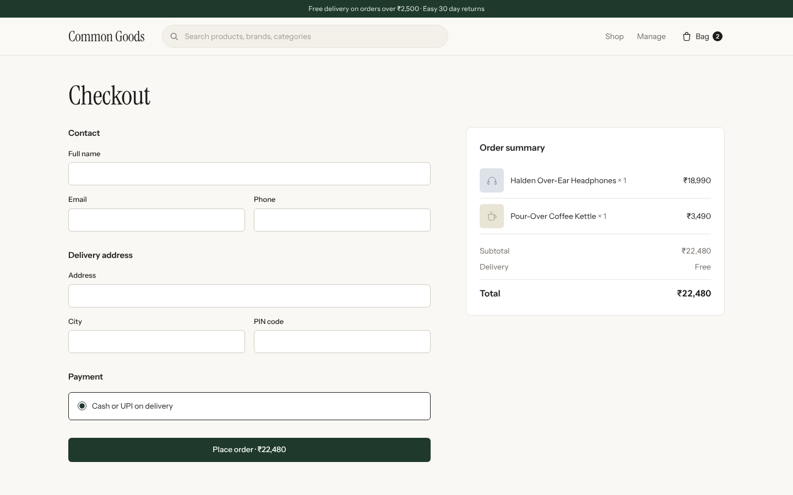 |
| Bag drawer | Checkout |
| 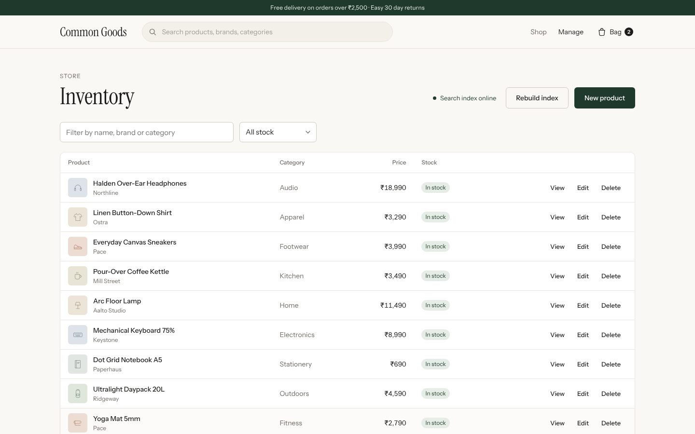 | 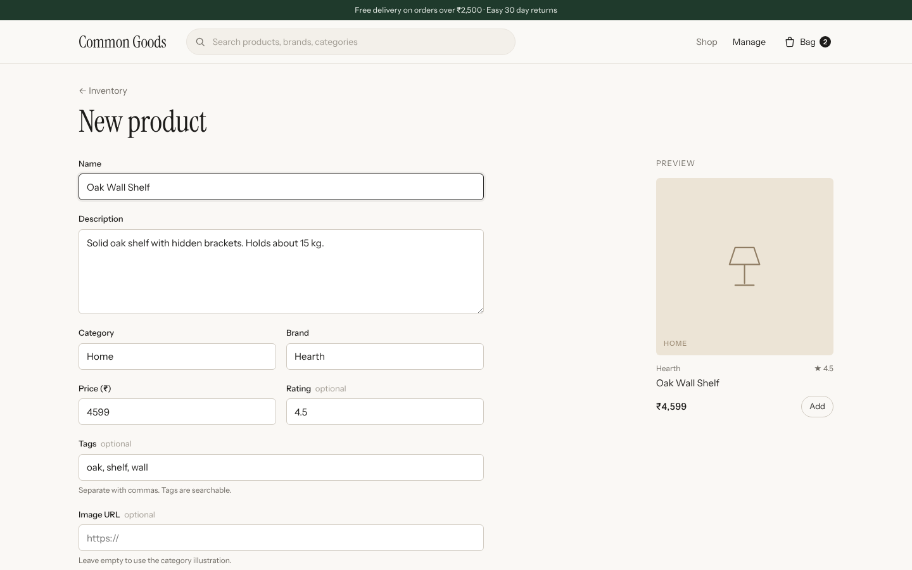 |
| Inventory | Adding a product |
| 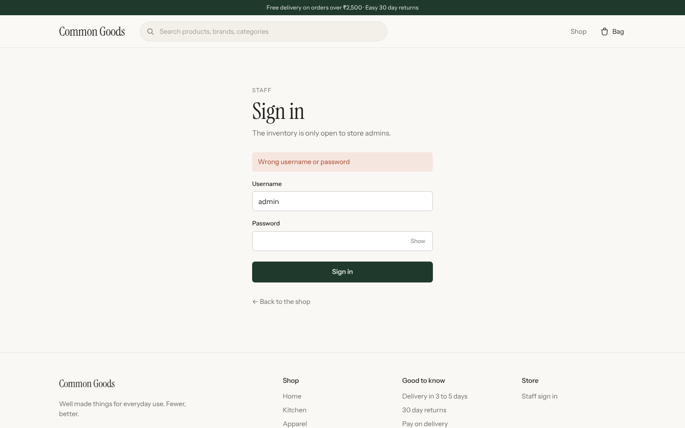 | |
| Staff sign in | |

<p>
  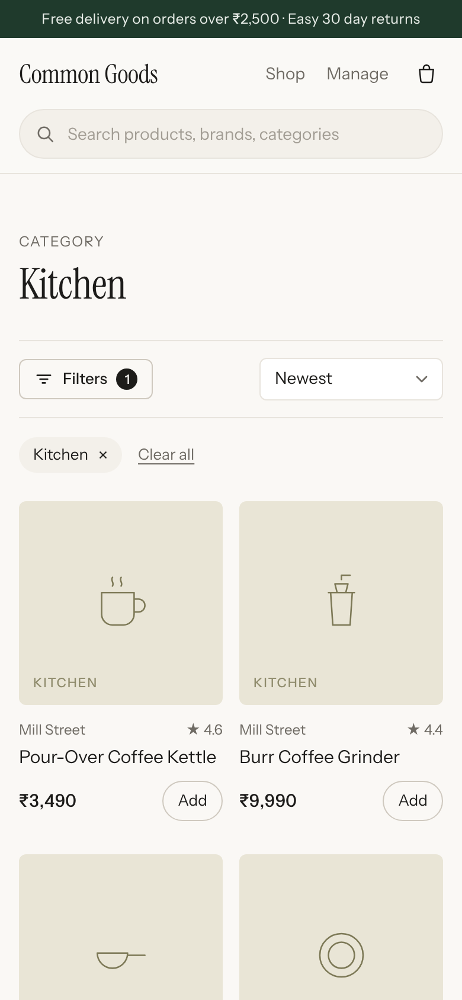
  &nbsp;
  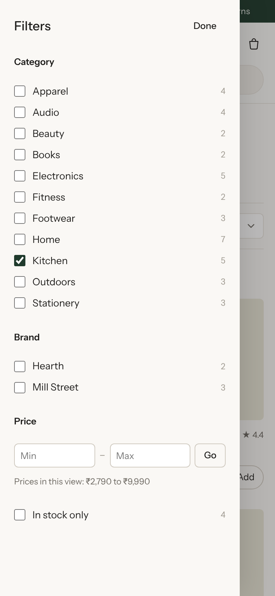
</p>

## Tech stack

- **Frontend:** Angular 17 (standalone components, signals), TypeScript, plain CSS
- **Backend:** Node.js, Express, Mongoose
- **Database:** MongoDB
- **Search:** Elasticsearch 8
- **Tests:** Node's built-in test runner with Supertest for the API, Playwright for the browser

## Getting started

You'll need Node.js 18 or newer, and MongoDB and Elasticsearch running locally. The quickest way to get the last two is Docker:

```bash
docker compose up -d
```

That starts MongoDB on `27017` and Elasticsearch on `9200` (security turned off, which is fine for local work only).

### Backend

```bash
cd backend
cp .env.example .env
npm install
npm run hash-password   # choose an admin password, paste the output into .env
npm run seed            # loads 40 sample products and builds the index
npm start               # http://localhost:3000
```

Sign in at `http://localhost:4200/login` with `ADMIN_USERNAME` and the password you chose. Without those settings the shop still works, but nobody can edit products.

`npm run seed` leaves existing data alone. Use `npm run seed -- --fresh` to wipe and reload.

### Frontend

```bash
cd frontend
npm install
npm start         # http://localhost:4200
```

The dev server proxies `/api` to `localhost:3000` (see `frontend/proxy.conf.json`), so there's nothing else to configure.

### Environment variables

| Name | Default | What it does |
|---|---|---|
| `PORT` | `3000` | API port |
| `MONGODB_URI` | none, required | MongoDB connection string |
| `ELASTICSEARCH_NODE` | `http://localhost:9200` | Elasticsearch URL |
| `ES_INDEX` | `products` | Name of the index alias |
| `ELASTICSEARCH_USERNAME`, `ELASTICSEARCH_PASSWORD` | none | When Elasticsearch has security on |
| `ELASTICSEARCH_API_KEY` | none | Alternative to username and password |
| `ELASTICSEARCH_CA_CERT` | none | Path to a CA file for Elasticsearch over https |
| `ADMIN_USERNAME` | none | Admin username |
| `ADMIN_PASSWORD_HASH` | none | From `npm run hash-password` |
| `JWT_SECRET` | none | From `npm run hash-password` (signs session cookies) |
| `SESSION_HOURS` | `8` | How long an admin stays signed in |
| `CORS_ORIGIN` | any in dev, none in production | Comma separated origins allowed to call the API from another domain |

## API

All routes are under `/api`. Routes marked **admin** need an admin session (sign in first; the session is kept in a cookie).

| Method | Route | Notes |
|---|---|---|
| GET | `/health` | Status of MongoDB and Elasticsearch |
| POST | `/auth/login` | `{ "username", "password" }`. Sets the session cookie |
| GET | `/auth/me` | `{ "username" }`, or `null` when not signed in |
| POST | `/auth/logout` | Clears the session |
| GET | `/products` | Paged list, newest first. `?page=&limit=` |
| GET | `/products/search` | Full search, see below |
| GET | `/products/suggest?q=` | Autocomplete: up to 6 products and 3 categories |
| GET | `/products/meta` | Distinct categories and brands |
| GET | `/products/:id` | One product |
| POST | `/products` | **admin** Create |
| PUT | `/products/:id` | **admin** Replace (fields left out go back to defaults) |
| PATCH | `/products/:id` | **admin** Update only the fields sent |
| DELETE | `/products/:id` | **admin** Delete |
| POST | `/products/reindex` | **admin** Rebuild the search index from MongoDB |

### Search parameters

| Param | Example | |
|---|---|---|
| `q` | `wireless headphones` | Free text. Searches name, brand, category, tags and description |
| `category` | `Kitchen,Home` | One or more, case insensitive |
| `brand` | `Pace` | One or more, case insensitive |
| `minPrice`, `maxPrice` | `1000`, `5000` | Swapped automatically if reversed |
| `inStock` | `true` / `false` | Leave out to include both |
| `sort` | `price_asc` | `relevance`, `newest`, `price_asc`, `price_desc`, `rating`, `name` |
| `page`, `limit` | `2`, `24` | `limit` is capped at 60 |

The response includes the matching items, totals, facet counts (categories, brands, price range, in stock count), a `didYouMean` suggestion when nothing matched, and `source`, which is `elasticsearch` normally or `database` when it had to fall back.

Bad input gets a `400` with a message per field:

```json
{
  "error": "Please fix the highlighted fields",
  "fields": { "price": "Price cannot be negative" }
}
```

### Product fields

| Field | Type | Rules |
|---|---|---|
| `name` | string | required, up to 160 characters |
| `description` | string | required, up to 4000 characters |
| `category` | string | required |
| `brand` | string | required |
| `price` | number | required, 0 or more, rounded to 2 decimals |
| `tags` | string[] or comma separated string | lowercased and de-duplicated, max 20 |
| `inStock` | boolean | defaults to `true` |
| `rating` | number | optional, 0 to 5 |
| `image` | string | optional http(s) URL. Without one the UI draws a category illustration |

## How search works

The `products` name in Elasticsearch is an alias pointing at a versioned index such as `products_v1729331234`. Fields are mapped with a few variations each:

- `name` uses the English analyzer (so "lamps" matches "lamp"), plus an edge n-gram version for search-as-you-type and a plain version used for spelling suggestions
- `category` and `brand` are keywords for exact filtering and facet counts, with a lowercase copy for case-insensitive filters and a text copy so they're searchable
- `price` is a scaled float, `inStock` a boolean

A query combines a cross-field match (every word has to appear, but not all in the same field), a fuzzy match for typos, a prefix match for half-typed words, and a phrase boost on the name. Facets are built so each one ignores its own filter, meaning ticking a brand doesn't hide the other brands.

## Tests

The API tests run against a real MongoDB and Elasticsearch, using a separate `productsearch_test` database and `products_test` index so they don't touch your data.

```bash
cd backend
npm test
```

They cover sign-in and the protected routes (including forged cookies and the lockout), CRUD, validation, every search option, pagination limits, junk and injection-style input, facets, autocomplete, reindexing, and the fallback when Elasticsearch is down.

The browser tests need the backend running with the sample data loaded:

```bash
cd frontend
npm run e2e
```

To run the same tests against a live site: `E2E_BASE_URL=https://your-domain E2E_ADMIN_PASSWORD=... npm run e2e`. Note that this creates and then deletes a test product.

## Deploying

[docs/DEPLOY-ORACLE.md](docs/DEPLOY-ORACLE.md) walks through putting the whole thing on a free Oracle Cloud VM, step by step: MongoDB and Elasticsearch with passwords and no public ports, automatic HTTPS through Caddy, backups and updates. Everything runs from `docker-compose.prod.yml`.

They use the admin login from `backend/.env` (set `E2E_ADMIN_PASSWORD` if yours isn't `local-admin-pass`). They go through signing in and out, searching, autocomplete, filters, sorting, paging, the back button, the bag, checkout validation, creating, editing and deleting a product, and the mobile layout.

## Project structure

```
backend/
  app.js                    Express app, error handling, health check
  server.js                 Startup, index sync, graceful shutdown
  config/
    database.js             MongoDB connection with retries
    elasticsearch.js        Client, index settings and mapping
  middleware/auth.js        Admin session check
  models/Product.js         Mongoose schema and validation
  routes/products.js        REST routes
  routes/auth.js            Sign in, sign out
  services/
    elasticsearchService.js Indexing, search, suggestions, reindex
    databaseSearch.js       MongoDB fallback search
  scripts/seed.js
  scripts/hash-password.js  Makes the admin password hash
  data/products.json        Sample catalogue
  tests/

frontend/
  src/app/
    core/                   API service, cart, toasts, types
    shared/                 Product card, artwork, search box, price pipe
    pages/
      shop/                 Listing, filters, URL state
      product/              Product page
      cart/                 Bag drawer and checkout
      admin/                Sign in, inventory and product editor
  e2e/                      Playwright tests

deploy/                     Caddyfile and first-run scripts for production
docker-compose.yml          MongoDB + Elasticsearch for local dev
docker-compose.prod.yml     Everything, for a production server
```

## Notes

- Checkout is a demo. It validates the form and shows a confirmation, but no order is stored and no payment is taken.
- There's a single admin account, set through environment variables. There are no customer accounts.
